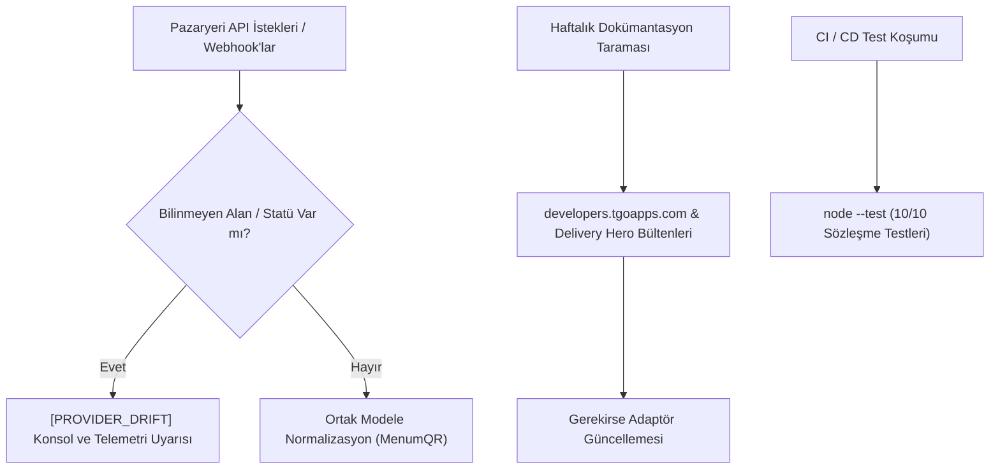

# Pazaryeri API Kaynakları, Dokümantasyon Linkleri ve Sürüm Takip Rehberi

Bu belge, **Yemek-Pazaryeri-Entegrasyon** projesinin kullandığı tüm resmi pazaryeri API'lerinin dokümantasyon adreslerini, geliştirici portallarını, değişiklik bültenlerini (changelog) ve sürüm güncelliğini sürekli denetleme yöntemlerini içerir.

---

## 1. Resmi API Dokümantasyon ve Kaynak Bağlantıları

### 1.1. Uber Eats Trendyol Go (Trendyol Yemek - TGO)

| Kaynak / Alan | Bağlantı & Referans | Açıklama |
| :--- | :--- | :--- |
| **Resmi Geliştirici Portalı** | [developers.tgoapps.com](https://developers.tgoapps.com/) | Ana portal, API referansı ve servis dökümleri |
| **Duyurular ve Güncellemeler (Changelog)** | [developers.tgoapps.com Duyurular](https://developers.tgoapps.com/) | Sürüm duyuruları, TLS ve model değişiklikleri |
| **Uber Eats Geçiş Dokümanı** | [Uber Eats Migration Changes](https://developers.tgoapps.com/en/docs/uber-eats-migration/meal-uber-eats-migration-changes) | `Galaxy`, `UberEats`, `userInformation.appName` geçişi |
| **Yemek Sipariş Paketlerini Çekme** | [Yemek Sipariş Paketleri](https://developers.tgoapps.com/docs/trendyol-go-yemek-entegrasyonu/siparis-entegrasyonu/ymk-siparis-paketlerini.cekme) | `/packages` ve `/packages/{id}` payload şeması |
| **Siparişi Kabul Etme (`picked`)** | [Sipariş Hazırlama Süresi Bildirme](https://developers.tgoapps.com/docs/trendyol-go-yemek-entegrasyonu/siparis-entegrasyonu/ymk-siparis-hazirlama-sure-bildirme) | `PUT /packages/picked` (`preparationTime`) |
| **Sipariş İptal (`unsupplied`)** | [Sipariş İptal Servisi](https://developers.tgoapps.com/docs/trendyol-go-yemek-entegrasyonu/siparis-entegrasyonu/ymk-siparis-iptal) | `PUT /packages/unsupplied` (`itemIdList`, `reasonId`) |
| **Yetkilendirme (Auth)** | [TGO Authorization](https://developers.tgoapps.com/docs/authorization) | Basic Auth, `x-agentname`, `x-executor-user` |
| **Ortam Adresleri** | **Stage:** `https://stageapi.tgoapis.com`<br>**Prod:** `https://api.tgoapis.com` | Canlı ve test ağ geçitleri |

---

### 1.2. Yemeksepeti (Delivery Hero Partner Integration)

| Kaynak / Alan | Bağlantı & Referans | Açıklama |
| :--- | :--- | :--- |
| **Delivery Hero Partner Portal** | [partner.deliveryhero.io](https://partner.deliveryhero.io/) | Global ve Türkiye restoran partner entegrasyonu |
| **Yemeksepeti Restoran Paneli** | [goweb.yemeksepeti.com](https://goweb.yemeksepeti.com/) | Restoran şube yönetimi ve API token ayarları |
| **Delivery Hero POS & Vendor API Docs** | [Delivery Hero Integration Docs](https://deliveryhero.io/) | Sipariş alma, durum güncelleme ve kurye takibi |
| **Kimlik Doğrulama (Auth)** | `POST /v1/oauth/token` (`grant_type=client_credentials`) | OAuth 2.0 Bearer token protokolü |
| **Ortam Adresleri** | **Sandbox:** `https://sandbox.partner.deliveryhero.io`<br>**Prod:** `https://partner.deliveryhero.io` | Global ve yerel ağ geçitleri |

---

### 1.3. GetirYemek (Getir Food Partner API)

| Kaynak / Alan | Bağlantı & Referans | Açıklama |
| :--- | :--- | :--- |
| **Geliştirici Portalı** | [developers.getir.com](https://developers.getir.com/) | Getir geliştirici merkezi ve başvuru |
| **Getir Restoran Paneli (Test)** | [food-panel-frontend.fooddev.getirapi.com](https://food-panel-frontend.fooddev.getirapi.com/) | Restoran ve entegrasyon test ekranı |
| **Entegrasyon Destek E-posta** | `getiryemekapi@getir.com` | Doğrudan entegrasyon API anahtarları başvurusu |
| **Kimlik Doğrulama (Auth)** | `x-api-key: GETIR_API_KEY`<br>`token: GETIR_RESTAURANT_SECRET_KEY` | Header bazlı çift anahtar yetkilendirmesi |
| **Ortam Adresleri** | **Dev:** `https://food-external-api-gateway.fooddev.getirapi.com`<br>**Prod:** `https://food-external-api-gateway.getirapi.com` | REST API uç noktaları |

---

### 1.4. Migros Yemek (Migros One Restoran API)

| Kaynak / Alan | Bağlantı & Referans | Açıklama |
| :--- | :--- | :--- |
| **Migros Restoran Portalı** | Migros Restoran Paneli -> *Restoran Bilgileri* > *POS Entegrasyonları* | `API Key` ve `StoreId` tanımlama alanı |
| **Sipariş ve Durum Servisleri** | `/Order/GetOrders`, `/Order/GetOrderDetail`<br>`/Order/v2/UpdateOrderStatus` | Sipariş listeleme ve durum bildirme |
| **Kimlik Doğrulama (Auth)** | `XApiKey: MIGROS_API_KEY` | Header bazlı yetkilendirme |
| **Ortam Adresleri** | **Test:** `https://test-yemek-api.migrosone.com`<br>**Prod:** `https://yemek-api.migrosone.com` | Migros One API sunucuları |

---

## 2. API Kaynaklarının Güncelliğini Sürekli Kontrol Etme Sistemi

Pazaryeri API'lerinin sözleşme (contract) değişikliklerini kesintisiz izlemek için 3 kademeli denetim uygulanır:



### Kademe 1: Çalışma Zamanı Şema Kayması Uyarısı (Runtime Drift Alerting)
Tüm adaptörlerimizde (`tgo.js`, `yemeksepeti.js`, `getir.js`, `migros.js`) bilinmeyen bir durum, ödeme tipi veya kanal adı geldiğinde sessizce yutulmaz; anında loglanır:
```text
[TGO_DRIFT] Bilinmeyen kaynak uygulama (appName): "YeniPazaryeri" (sipariş ID: 12345)
[TGO_DRIFT] Bilinmeyen paket durumu (packageStatus): "InTransit" (sipariş ID: 12345)
```
Bu sayede sağlayıcı yeni bir alan eklediğinde kod bozulmaz, ancak sistem yöneticisi ve MenumQR ekibi derhal haberdar olur.

### Kademe 2: Otomatik Birim ve Sözleşme Testleri
Her dağıtımdan önce `node --test` çalıştırılır. Test havuzunda gerçek sağlayıcı yanıt şablonları yer alır; sağlayıcı sözleşmesinde geriye uyumsuz bir değişiklik olduğunda testler derhal hata verir.

### Kademe 3: Periyodik Dokümantasyon Kontrolü
Her ayın 1. ve 15. günlerinde [developers.tgoapps.com](https://developers.tgoapps.com/) üzerindeki "Duyurular" sekmesi taranarak yeni alan zorunlulukları (örneğin yeni yemek kartı ödeme kodları veya iptal reasonId güncellemeleri) incelenir.
